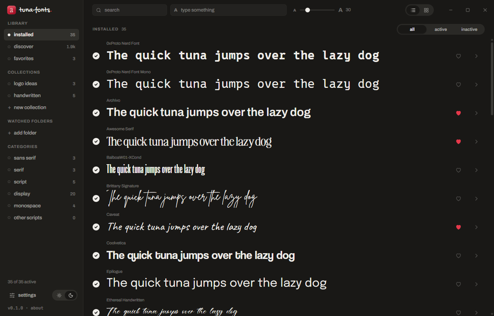

First version of tuna-fonts, a font manager for Windows 10 and 11.

### What's in it

- Installed fonts grouped by family, as a list or a grid, previewed with your own text and size.
- Activate and deactivate fonts without deleting them.
- Install `.ttf`, `.otf` and `.ttc` by dropping them on the window, just for you or for every user.
- Discover: the Google Fonts catalog with one-click install.
- Favorites, collections, a multi-select bar, specimen with the real character map, and compare 2 to 4 fonts.
- Watched folders: their fonts are available while the app is open, without installing them.
- System fonts locked and hidden by default; they can be unlocked in settings (asks for admin rights, keeps a backup, never touches the ones Windows needs).
- Light and dark theme, Spanish and English, editable shortcuts.

### Install

Download `tuna-fonts_0.1.0_x64-setup.exe` below and run it. It installs for your user only, no admin rights needed. The installer isn't code-signed, so SmartScreen may warn you the first time: **More info → Run anyway**.
