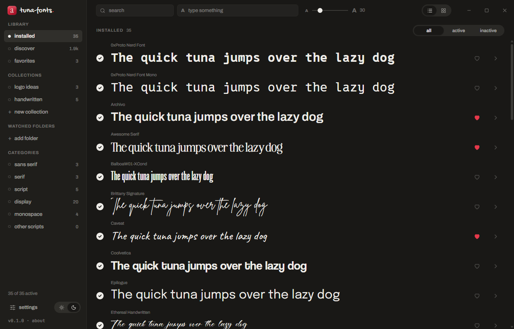

**tuna-fonts 0.2.0 — what people asked for on r/coolgithubprojects.** Thank you all.

### Asked for on Reddit
- **Starts in your Windows language.** The first time, it opens in Spanish if Windows is in Spanish and in English otherwise (it always started in Spanish). After that, whatever you pick in settings.
- **Installs in `%LOCALAPPDATA%\Programs\tuna-fonts`**, the standard place for per-user apps, instead of `%LOCALAPPDATA%\tuna-fonts`.
- **Ctrl + mouse wheel** changes the preview size instead of zooming the window. The size slider now goes down to 10.
- **Favorites in Discover**, as a wishlist. The heart on a Google font saves it in your favorites **without installing it**; there it shows as *not installed*, with a live preview and its install button. Installing it keeps it as a favorite, and so does deactivating it.
- **Tidier sidebar.** *New collection* and *add folder* are now a small **+** next to their headings. A new collection is named in place and only created when you press Enter.
- **Updates itself.** When there's a new version it tells you, and one click installs it and reopens the app. Only packages signed with the project's key are accepted. You can turn the startup check off in *settings → check for updates on startup*.
- **winget** is on its way: the manifest is ready and goes out after this release.

### Also new
- The tick, the heart and the arrow in each row are centered with the whole row, and so is the install button in Discover.
- Fonts with big flourishes no longer spill out: the "Aa" in the grid is measured and shrunk to fit its card, the size scale in the specimen wraps instead of being cut off, and there's room above and below for swashes.
- The selection bar slides up from the middle, the settings window keeps its title and close button in place while you scroll, the window buttons are rounded like the rest of the app, and the empty "click + to…" hints are gone.
- Folders (Programs, Fonts, AppData) are asked from Windows as known folders instead of being built from environment variables.
- *About* links to the other tuna app ([tuna-dlp](https://github.com/atunfrito/tuna-dlp)) and to the bug report form.
- Built by GitHub Actions from the tagged source, with a portable `.zip` and the SHA-256 of every file below.

### Coming from 0.1.0
Run the new installer once. It removes the old copy from `%LOCALAPPDATA%\tuna-fonts` and keeps all your data: settings, favorites, collections, shortcuts, watched folders and your deactivated fonts. From 0.2.0 on, updates are automatic. If you had tuna-fonts pinned to the taskbar, pin it again: the old pin points to the old folder.

### Downloads
- **`tuna-fonts_0.2.0_x64-setup.exe`**: installer (per user, no admin rights needed). Updates itself.
- **`tuna-fonts_0.2.0_x64-portable.zip`**: portable version; unzip and run `tuna-fonts.exe`. It tells you when there's a new version but doesn't update itself.

Windows 10/11, 64-bit. **Not code-signed**, so Windows SmartScreen may warn you the first time: *More info → Run anyway*.

Stay in the loop: *Watch → Custom → Releases*. Found a bug? [Open an issue](https://github.com/atunfrito/tuna-fonts/issues/new/choose).

---

**En español:** la 0.2.0 trae lo que pedisteis en Reddit. La primera vez arranca en el idioma de Windows. Se instala en `%LOCALAPPDATA%\Programs\tuna-fonts`. Control + rueda cambia el tamaño de las muestras, que ahora baja hasta 10. El corazón en Descubrir guarda la fuente en favoritas sin instalarla, como lista de deseos. La barra lateral tiene un **+** para crear colecciones y añadir carpetas. Y la app se actualiza sola (se puede desactivar en ajustes), aceptando solo paquetes firmados. Además, los iconos de cada fila van centrados y las fuentes con adornos grandes ya no se salen de su tarjeta ni del espécimen. Si vienes de la 0.1.0, abre el instalador nuevo una vez: quita la vieja y conserva todos tus datos, también las fuentes desactivadas. Si la tenías anclada a la barra de tareas, vuelve a anclarla.
