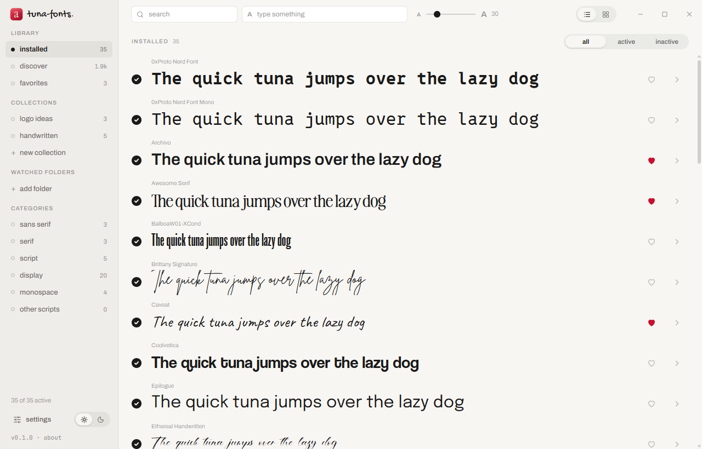
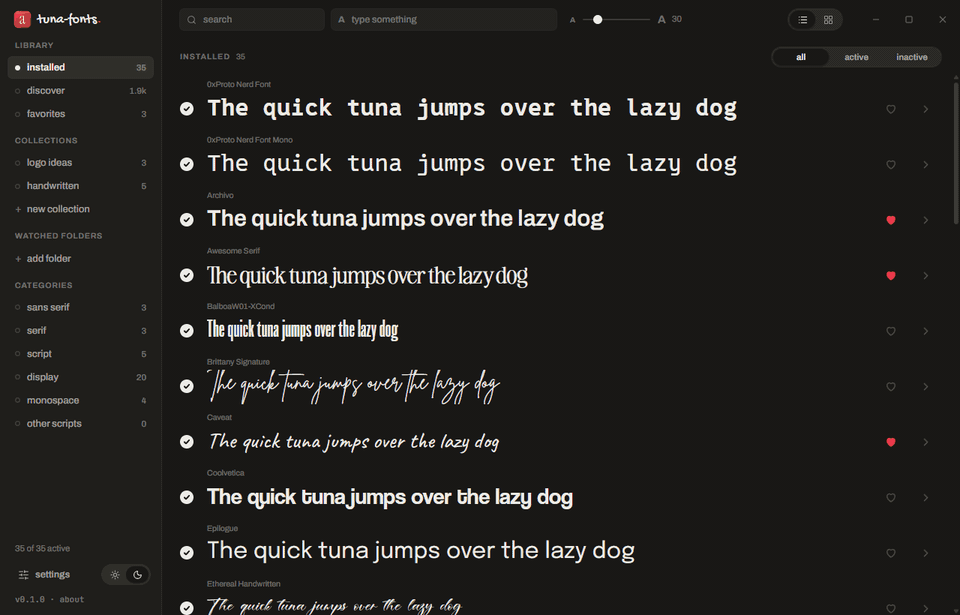
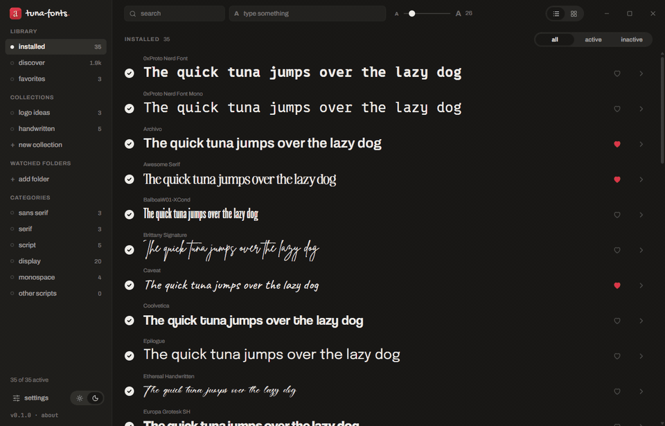
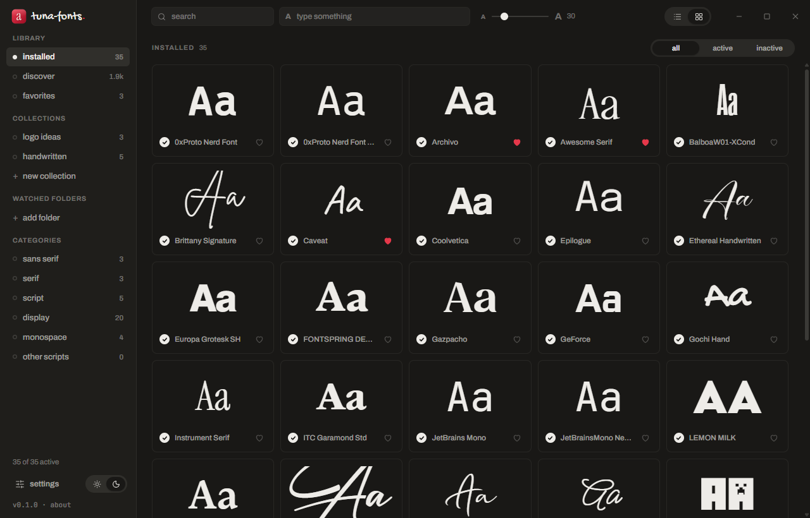
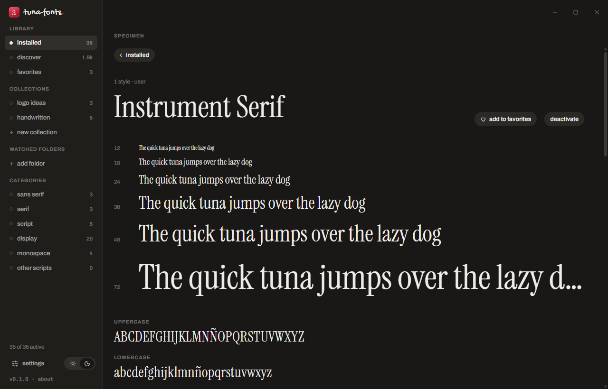
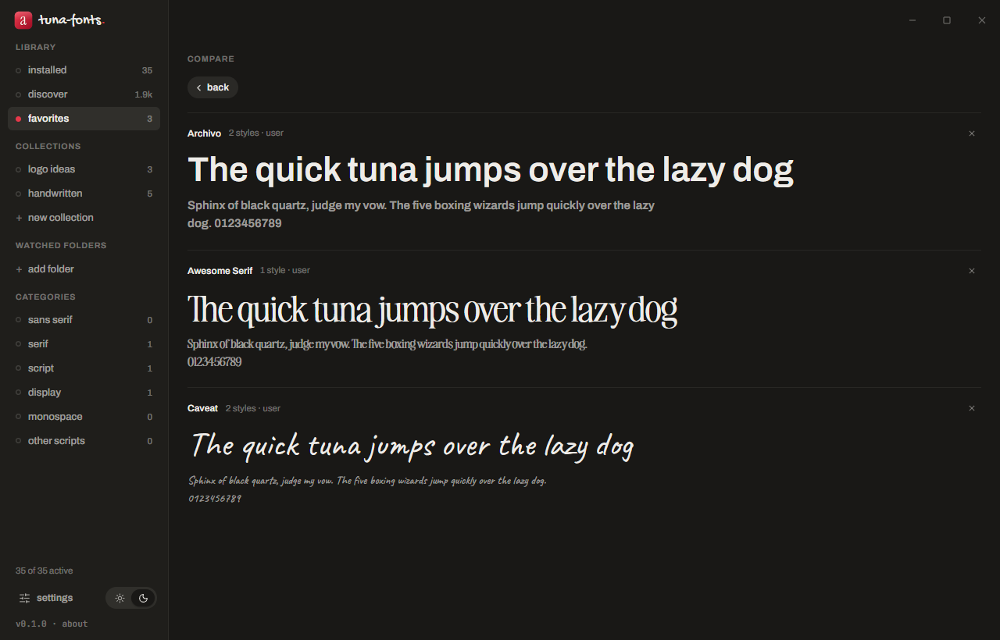
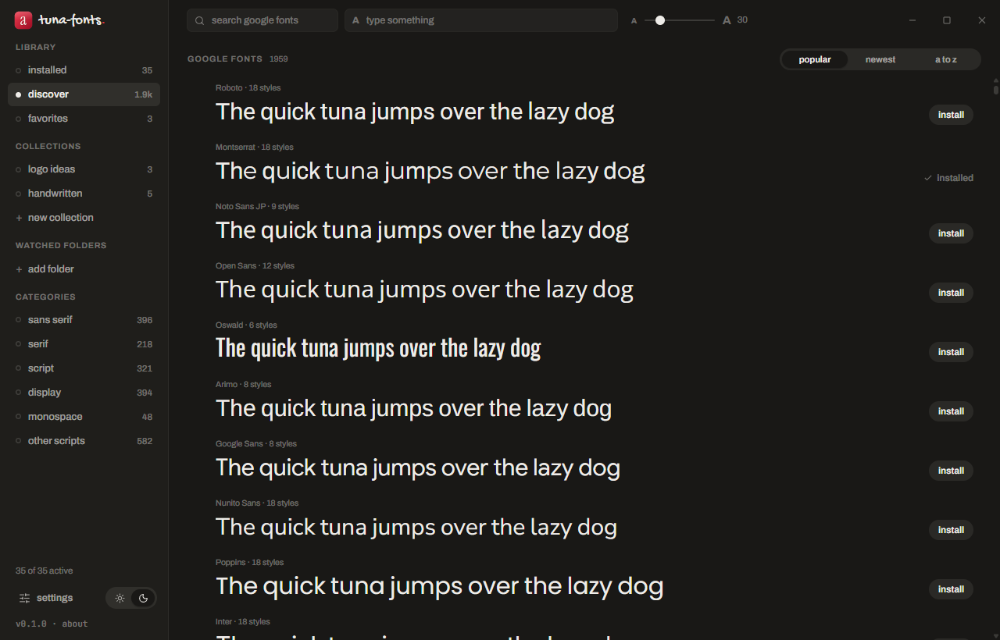
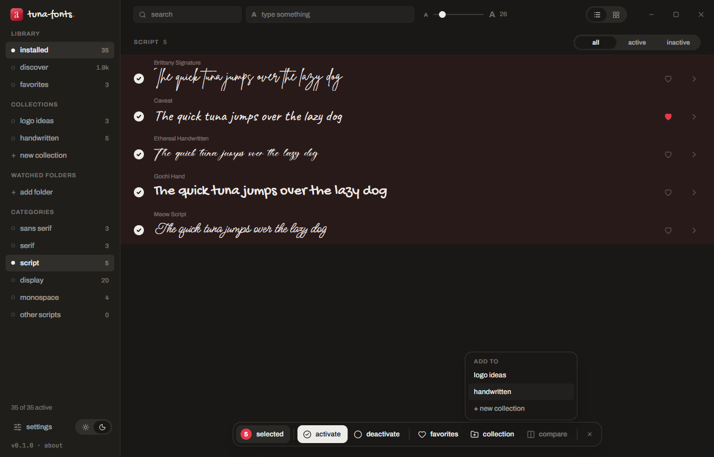
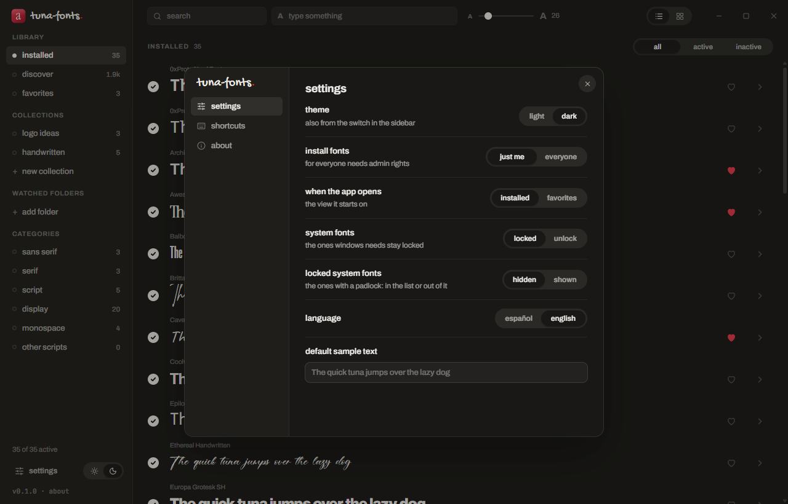

<div align="center">


# tuna-fonts

**A font manager for Windows 10 and 11.**
Your fonts, tidy and at hand. No accounts, no ads, nothing sent anywhere.

[English](#what-it-does) · [Español](#en-español)

</div>

<picture>
  <source media="(prefers-color-scheme: dark)" srcset="docs/list-dark.png">
  
</picture>

## What it does

- **See every font you have**, grouped by family, as a list or a grid. Each one is previewed with your own text, at the size you pick.
- **Activate and deactivate without deleting.** A deactivated font disappears from your apps but stays safe in tuna-fonts, ready to come back with one click.
- **Install by dropping** `.ttf`, `.otf` or `.ttc` files on the window — just for you (no admin rights) or for every user.
- **Discover** the whole Google Fonts catalog (about 1,900 families) and install any of them in one click.
- **Favorites and collections** to keep the fonts for each project together, and a selection bar to act on many at once. Favorites work as a wishlist too: heart a Google font in Discover and it waits in your favorites, not installed, until you want it.
- **Specimen** with the real character map of the font (click a glyph to copy it), and **compare** 2 to 4 fonts side by side.
- **Watched folders**: point it at a folder and its fonts are available while the app is open, without installing them.
- **Categories** worked out from the font itself: sans serif, serif, script, display, monospace and other scripts.
- **Ctrl + mouse wheel** changes the preview size anywhere in the list.
- Light and dark theme, Spanish and English (it starts in your Windows language), editable keyboard shortcuts.
- **Updates itself**: when there's a new version it tells you, and one click installs it. Only packages signed with the project's key are accepted.

### Type and see it everywhere



### Light or dark, list or grid



### More screenshots

| | |
|---|---|
|  |  |
| **Grid** — an "Aa" card for each family | **Specimen** — sizes, alphabet, numbers and every character |
|  |  |
| **Compare** — 2 to 4 fonts with the same text | **Discover** — Google Fonts, sorted by popularity, newest or A–Z |
|  |  |
| **Selection bar** — activate, favorite, collect or compare many at once | **Settings** — theme, where to install, system fonts, language |

## System fonts, safely

Fonts that come with Windows are **locked by default** and hidden from the list, so you can't break anything by accident. If you really want to, you can unlock them in settings:

- Changing a system font asks for admin rights (UAC) each time.
- Before removing one, tuna-fonts keeps a copy of the file and its registry entry, and **"restore all system fonts"** puts everything back.
- The fonts Windows itself needs (Segoe UI and friends) stay locked no matter what.

## Privacy

Everything happens on your computer. No telemetry, no account. The app only goes online for two things:

- **Google Fonts** (`fonts.google.com` and `fonts.gstatic.com`), when you open Discover, install from it, or have Google fonts in your favorites.
- **One request to GitHub on startup** to read `latest.json` from the latest release and see if there's a new version. Nothing is sent about you or your fonts. You can turn it off in *settings → check for updates on startup* (then it only checks when you press *check now*).

## Install

Download `tuna-fonts_x.y.z_x64-setup.exe` from the [latest release](https://github.com/atunfrito/tuna-fonts/releases/latest) and run it. It installs for your user only, in `%LOCALAPPDATA%\Programs\tuna-fonts`, and doesn't need admin rights. From then on it updates itself.

Coming from 0.1.0 (which installed in `%LOCALAPPDATA%\tuna-fonts`)? Just run the new installer: it removes the old copy and keeps all your data — settings, favorites, collections, shortcuts, watched folders and your deactivated fonts.

There's also a portable `.zip`: unzip it and run `tuna-fonts.exe`. It tells you when there's a new version but doesn't update itself.

The installer isn't code-signed, so Windows SmartScreen may warn you the first time: click **More info → Run anyway**.

Every release from 0.2.0 on is built by GitHub Actions straight from the tagged source ([`release.yml`](.github/workflows/release.yml)), signed for the updater, and the SHA-256 of each file is listed in the release notes. (0.1.0 was built locally.)

**Stay in the loop:** *Watch → Custom → Releases* on this repository to get an email for each new version.
**Found a bug?** [Open an issue](https://github.com/atunfrito/tuna-fonts/issues/new/choose) — English or Spanish.

### Build it yourself

You need [Node 22+](https://nodejs.org), [Rust](https://rustup.rs) stable and the WebView2 runtime (already included in Windows 11).

```bash
git clone https://github.com/atunfrito/tuna-fonts
cd tuna-fonts
npm install
npm run instalador
```

The installer ends up in `src-tauri/target/release/bundle/nsis/`.

Other commands:

```bash
npm run dev     # run in development, with hot reload
npm run build   # just tuna-fonts.exe, in src-tauri/target/release
cargo test --manifest-path src-tauri/Cargo.toml
```

The tests cover category detection and a full install → deactivate → activate cycle with a bundled test font and a throwaway registry key.

### Making a release

1. Bump `version` in `package.json` and `src-tauri/tauri.conf.json` (they must match).
2. Write the notes in `.github/notas/vX.Y.Z.md`.
3. Commit, then push a tag: `git tag vX.Y.Z && git push origin vX.Y.Z`.

The workflow checks the tag matches the version, runs the tests, builds the installer (signed for the updater with the `TAURI_SIGNING_PRIVATE_KEY` and `TAURI_SIGNING_PRIVATE_KEY_PASSWORD` secrets) and the portable zip, writes `latest.json`, and leaves a **draft** release with the notes and SHA-256 sums. Review it and publish it by hand: the updater only sees published releases. Publishing also sends the new version to winget (see [`winget/README.md`](winget/README.md)). Running the workflow manually (*Actions → release → Run workflow*) only builds and attaches the files to the run, without touching any release.

## How it's built

[Tauri 2](https://tauri.app) with a Rust backend and a [Svelte 5](https://svelte.dev) interface.

| Where | What |
|---|---|
| `src/` | Interface. Texts live in `src/i18n/es.js` and `en.js`. |
| `src-tauri/src/fuentes/leer.rs` | Reads the name, OS/2 and cmap tables straight from the font file (TTF, OTF and TTC). |
| `src-tauri/src/fuentes/categoria.rs` | Picks the category from panose, sFamilyClass, code pages and, as a last resort, the name. |
| `src-tauri/src/fuentes/cache.rs` | Caches what it has read, so opening the app is instant; new or changed files are read in parallel. |
| `src-tauri/src/fuentes/cambios.rs` | Activate, deactivate and install for the current user (files + `HKCU` registry). |
| `src-tauri/src/fuentes/sistema.rs` | The same for system fonts, run in an elevated copy of the app, with backups. |
| `src-tauri/src/google.rs` | Google Fonts catalog and downloads. |

App data (cache, deactivated fonts, system font backups) is kept in `%APPDATA%\es.atunfrito.tunafonts`.

## License

[MIT](LICENSE). The fonts bundled for the interface (Archivo, JetBrains Mono and Gochi Hand) are under the SIL Open Font License; see [THIRD-PARTY-NOTICES.md](THIRD-PARTY-NOTICES.md).

---

## En español

**Gestor de fuentes para Windows 10 y 11.** Tus fuentes, ordenadas y a mano. Sin cuentas, sin anuncios y sin enviar nada a ningún sitio.

- **Todas tus fuentes**, agrupadas por familia, en lista o cuadrícula, con tu propio texto de prueba y al tamaño que quieras.
- **Activar y desactivar sin borrar.** Una fuente desactivada deja de salir en tus programas, pero se queda guardada en tuna-fonts y vuelve con un clic.
- **Instalar arrastrando** `.ttf`, `.otf` o `.ttc` a la ventana: solo para ti (sin permisos) o para todos los usuarios.
- **Descubrir**: el catálogo entero de Google Fonts, con instalación en un clic.
- **Favoritas y colecciones** para tener juntas las fuentes de cada proyecto, y una barra de selección para hacer cosas con varias a la vez.
- **Espécimen** con el mapa de caracteres real (clic en un carácter para copiarlo) y **comparar** de 2 a 4 fuentes.
- **Carpetas vigiladas**: sus fuentes están disponibles mientras la app está abierta, sin instalarlas.
- Favoritas también como lista de deseos: el corazón en Descubrir la guarda en favoritas sin instalarla.
- Control + rueda del ratón cambia el tamaño de las muestras.
- Tema claro y oscuro, español e inglés (arranca en el idioma de Windows), y atajos de teclado editables.
- Se actualiza sola: avisa de la versión nueva y se instala con un clic. Solo acepta paquetes firmados con la clave del proyecto.

Las fuentes del sistema vienen **bloqueadas y ocultas** por defecto. Se pueden desbloquear en ajustes: pide permisos cada vez, guarda una copia antes de quitar nada y hay un botón para restaurarlas todas. Las imprescindibles para Windows no se tocan nunca.

Para instalarla, baja `tuna-fonts_x.y.z_x64-setup.exe` de la [última versión](https://github.com/atunfrito/tuna-fonts/releases/latest) y ábrelo. Se instala solo para tu usuario, en `%LOCALAPPDATA%\Programs\tuna-fonts`, sin pedir permisos. Si tenías la 0.1.0, el instalador nuevo quita la vieja y conserva todos tus datos, también las fuentes desactivadas. Como el instalador no está firmado, Windows SmartScreen puede avisar la primera vez: «Más información → Ejecutar de todas formas».

Lo único que sale a internet: Google Fonts cuando usas Descubrir, y una consulta a GitHub al abrir para ver si hay versión nueva (se desactiva en ajustes). Para enterarte de cada versión: *Watch → Custom → Releases*. ¿Algún fallo? [Abre un aviso](https://github.com/atunfrito/tuna-fonts/issues/new/choose), en español o en inglés.

Para compilarla tú hace falta Node 22+, Rust y WebView2:

```bash
npm install
npm run instalador
```

El instalador queda en `src-tauri/target/release/bundle/nsis/`.
